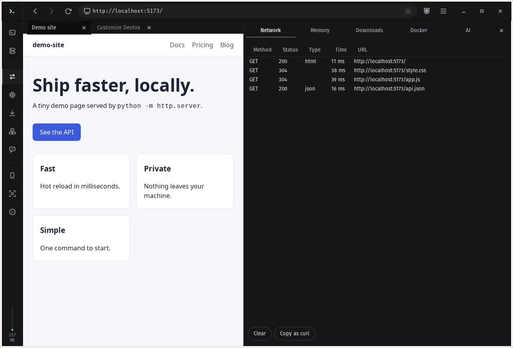
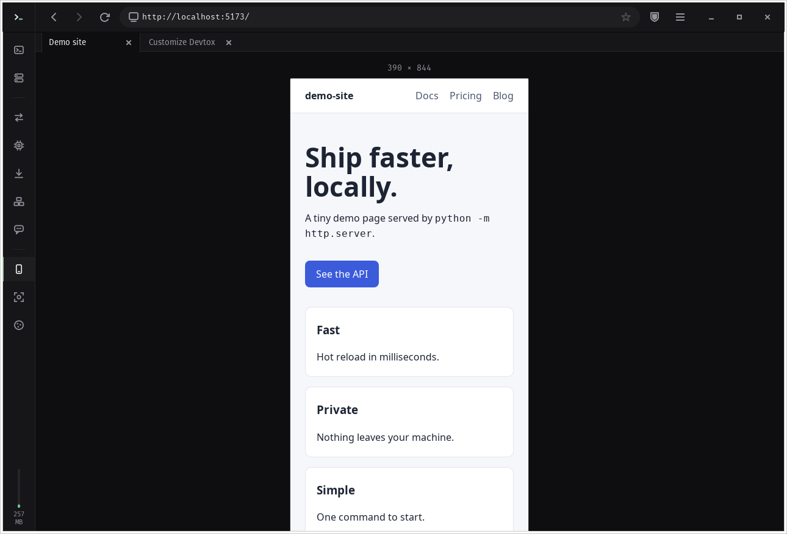
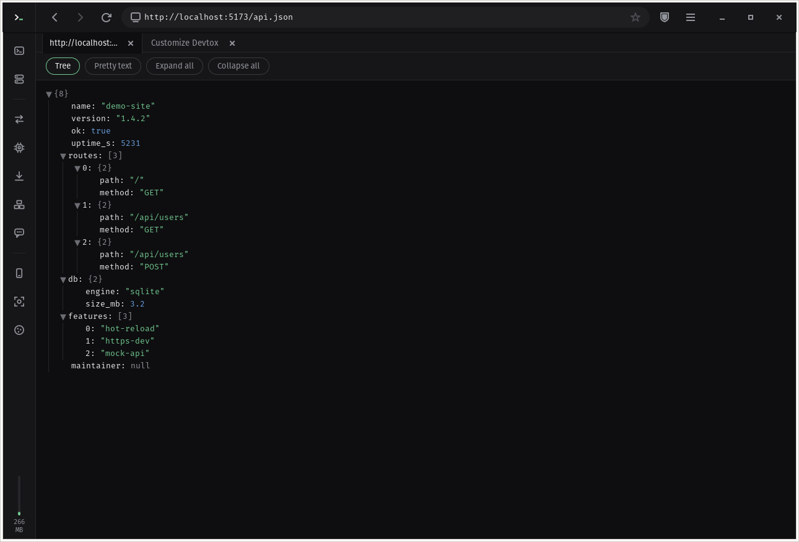
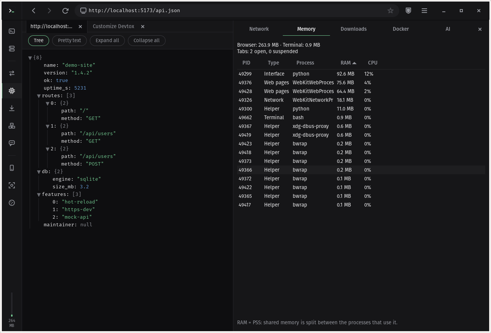
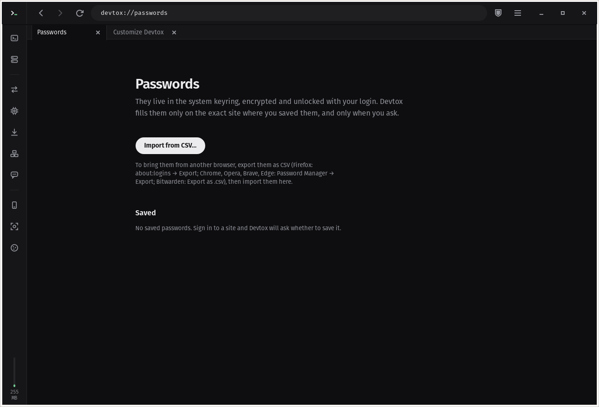
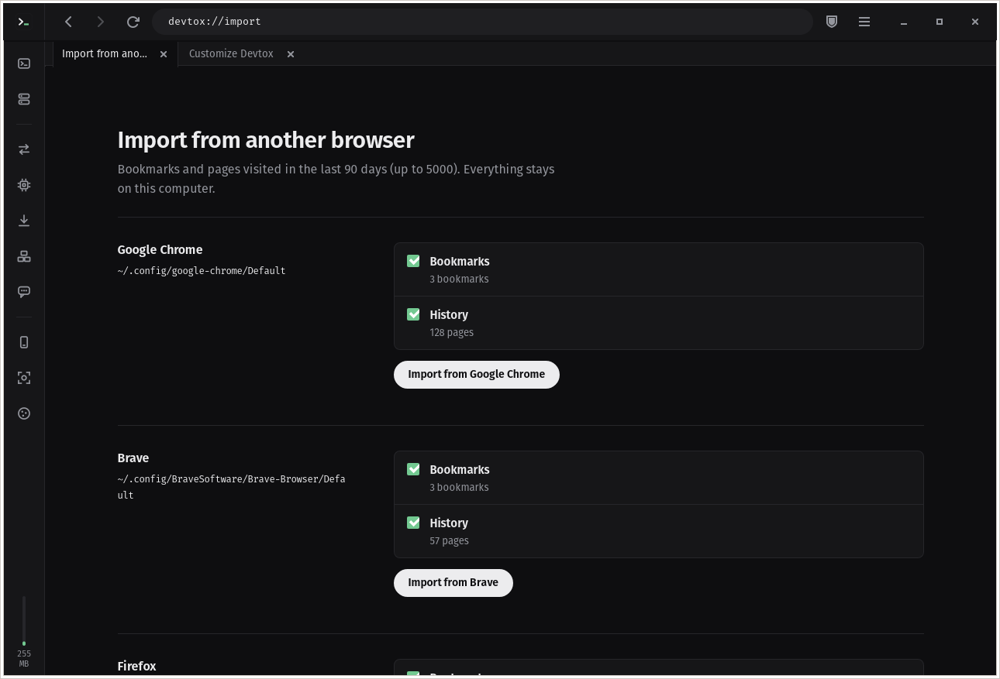

# Devtox

A lightweight web browser for Linux developers, with the terminal built in.


Devtox puts a WebKit browser and a real terminal (VTE) in the same window,
adds a command palette for everything, and ships with privacy defaults that you
can tune per site. It is written in Python on top of GTK 3 and WebKitGTK, so it
uses the web engine your distribution already keeps up to date.

> **Status: 0.1, early.** Interface in English and Italian.
> See [Known limitations](#known-limitations) before switching your daily browser.

```sh
git clone https://github.com/Tommaso-Palestini/devtox-browser.git && cd devtox-browser && sh install.sh
```

Needs a few system libraries first: see [Install](#install).

## Why

- **Browser + terminal, one window.** ``Ctrl+` `` slides a terminal up from the bottom;
  ``Ctrl+Shift+` `` opens another one. Ctrl+click the `http://localhost:5173/` your dev server
  prints and it opens in a new tab. No alt-tabbing between the dev server and the page.
- **Drive the browser from the shell.** `dx open localhost:5173`, `dx tabs`, `dx mem`.
- **Command palette.** `Ctrl+K` searches actions, open tabs, bookmarks and history.
- **Your dev servers, found for you.** The start page lists every server you are running
  (read from `/proc`, no configuration): port, tool (vite, next, django, http.server…),
  project folder and uptime. One click opens it, one click stops it (or all of them).
- **Docker in the sidebar.** `Ctrl+Shift+D` shows your containers grouped by compose
  project: start, stop, restart, logs in the terminal, published ports one click away.
  It talks only to the local Docker or Podman socket, and only while the panel is open.
- **Dev tools where you need them.** Network log with "copy as curl", responsive view, full-page screenshots, view source,
  JSON viewer, per-site cookies and storage, memory per process.
- **Local AI, optional.** Summarise a page or explain a selected error with a model
  running in [Ollama](https://ollama.com) on your machine. Nothing leaves your PC.
- **No telemetry.** No analytics, no update pings, no accounts. See [PRIVACY.md](PRIVACY.md).

| Start page | Command palette | First-run setup |
|---|---|---|
|  |  |  |

| Network log | Responsive view | JSON viewer |
|---|---|---|
|  |  |  |

| Memory per process | Password manager |
|---|---|
|  |  |

## Safe by default

- **Phishing protection.** Navigations are checked against the public
  [Phishing.Database](https://github.com/mitchellkrogza/Phishing.Database) list (MIT), kept on
  your computer: one small download a day, nothing about you is sent. Shared platforms
  (vercel.app, github.io, sites.google.com…) are never blocked whole.
- **Password manager.** Passwords live in the system keyring (GNOME Keyring, KWallet), are
  filled with one click and only on the exact site, and can be imported from the CSV export
  of Firefox, Chrome, Opera, Brave, Edge or Bitwarden (`devtox://passwords`).
- **Sandboxed pages.** Every web page process runs inside bubblewrap.

## Privacy defaults

| Protection | Default |
|---|---|
| HTTPS-only (except localhost and private networks) | on |
| Third-party cookies | blocked |
| Tracker blocklist (local file, editable) | on |
| Phishing protection (public list, checked locally) | on |
| Canvas/WebGL fingerprinting noise | on |
| Global Privacy Control (`Sec-GPC: 1` header + JS API) | on |
| Referer trimmed to the origin | on |
| Intelligent Tracking Prevention (WebKit) | on |
| WebRTC (can leak your local IP) | off |
| Camera, microphone, location, notifications | always denied |
| Private tabs (ephemeral profile, gone with the last private tab) | `Ctrl+Shift+N` |

The import page (`devtox://import`) reads bookmarks and recent history from Firefox,
Chrome, Chromium, Brave, Edge, Vivaldi, Opera, Zen and LibreWolf, including Flatpak and
Snap installs. Passwords and cookies stay where they are, and Tor Browser is never read.

Every protection can also be turned off per site from the shield in the address bar.
The blocklist is a plain text file that you own: nothing is downloaded behind your back.

## Install

You need Linux with Python 3.10 or newer and WebKitGTK 4.1 (any current
Debian/Ubuntu, Fedora or Arch has them). Installing takes about a minute and does not
need `sudo` except for the system libraries.

### 1. System libraries

GTK, WebKitGTK and VTE come from your distribution, not from pip:

```sh
# Debian, Ubuntu, Pop!_OS, Mint
sudo apt install python3-gi python3-gi-cairo gir1.2-gtk-3.0 gir1.2-webkit2-4.1 gir1.2-soup-3.0 \
    gir1.2-vte-2.91 gir1.2-secret-1 gcc pkg-config libglib2.0-dev

# Fedora
sudo dnf install python3-gobject python3-cairo gtk3 webkit2gtk4.1 libsoup3 vte291 libsecret \
    gcc pkgconf glib2-devel

# Arch
sudo pacman -S python-gobject python-cairo gtk3 webkit2gtk-4.1 libsoup3 vte3 libsecret gcc pkgconf glib2
```

Some of these are optional. Devtox starts without them and `devtox --check` shows what is off:

- `gcc`, `pkg-config` and the GLib headers are used only once, to compile a tiny
  WebKit extension that sends the GPC header and trims the Referer. Without them those
  two protections are off.
- libsecret (`gir1.2-secret-1`) is needed for the password manager. Without it the
  password manager is off.

If something required is missing, Devtox tells you the exact command for your
distribution instead of crashing.

### 2. Devtox

```sh
git clone https://github.com/Tommaso-Palestini/devtox-browser.git
cd devtox-browser
sh install.sh
```

`install.sh` copies the program into `~/.local` and adds the `devtox` and `dx`
commands, an entry in the applications menu and the icon. Check that everything is in place:

```sh
devtox --check
```

```
Devtox       0.1.0
WebKitGTK    2.52.6
GTK          3.24.41
VTE          0.76.0
Python       3.12.3
System       Linux-…
Extension    active (~/.cache/devtox/webext/libdxprivacy.so)
Log          ~/.local/state/devtox/devtox.log
```

If `devtox` is not found, `~/.local/bin` is not in your `PATH`: log out and back in,
or add `export PATH="$HOME/.local/bin:$PATH"` to `~/.profile`.

### 3. First start

Launch **Devtox** from the applications menu, or type `devtox` (or just `dx`) in a terminal.
The first window opens the setup page: pick the language, the search engine, the privacy
level, the ports your dev servers use and whether Devtox should be your default browser.
You can come back to it at any time from the menu (`devtox://setup`).


Coming from another browser? Open `devtox://import` (also in the menu and the command
palette) to bring over bookmarks and recent history. Passwords come separately, from a CSV
export, in `devtox://passwords`.



### Default browser

Choose it in the setup page, or from a terminal:

```sh
xdg-settings set default-web-browser io.github.Tommaso_Palestini.devtox-browser.desktop
```

Links from other apps and from the terminal then open in a new tab of the window that is
already open.

### Update

```sh
cd devtox-browser
git pull
sh install.sh
```

Your profile (settings, bookmarks, history, sessions) is kept.

### Uninstall

```sh
sh install.sh --uninstall
```

This removes the program and the menu entry. Your profile stays in `~/.config/devtox`,
`~/.local/share/devtox` and `~/.cache/devtox`: delete those folders too if you want
nothing left behind. Saved passwords stay in the system keyring as entries named
"Devtox: …" (open Passwords and Keys, or Seahorse, to remove them).

### Run from source

```sh
python3 -m venv --system-site-packages .venv
.venv/bin/python -m devtox
```

The Python package is called `devtox-browser`, like the repository; the program
it installs is `devtox`, and the shell command is `dx`.

## Keyboard

| Keys | Action |
|---|---|
| `Ctrl+K` | command palette |
| ``Ctrl+` `` / ``Ctrl+Shift+` `` | toggle terminal / new terminal |
| `Ctrl+T`, `Ctrl+W`, `Ctrl+Shift+T` | new, close, reopen tab |
| `Ctrl+Shift+N` | private tab |
| `Ctrl+L`, `Ctrl+F`, `Ctrl+D`, `Ctrl+U` | address bar, find, bookmark, source |
| `Ctrl+Shift+L` | local dev servers |
| `Ctrl+Shift+E`, `Shift+Esc`, `Ctrl+Shift+Y` | network, memory, downloads |
| `Ctrl+Shift+D` | Docker containers |
| `Ctrl+Shift+M`, `Ctrl+Shift+S` | responsive view, screenshot |
| `Ctrl+Shift+A` | local AI panel |
| `Ctrl+Shift+Delete` | site cookies and data |
| `F12` | WebKit inspector |

## Command line

```sh
devtox [URL ...]             # opens URLs; reuses the running window if there is one
devtox --check               # versions, privacy extension status, log path
devtox --new-instance        # do not hand URLs to the running window
dx                           # start Devtox from any folder (or bring it forward), frees the prompt
dx open <url or search>      # new tab in the running browser
dx tabs                      # list tabs (* current, z suspended)
dx mem                       # memory per process
dx servers                   # dev servers listening: port, tool, folder, uptime
dx stop 5173 | dx stop all   # stop dev servers (SIGTERM, like Ctrl+C)
```

## Memory

Measured with `dx mem` (PSS, so shared memory is counted once), WebKitGTK 2.52,
Pop!_OS 24.04, fresh profile:

| Open | Total |
|---|---|
| start page + welcome page + example.com | ~370 MB |
| the above + a Wikipedia article | ~520 MB |

Each tab gets its own web process. Background tabs are suspended after
15 minutes (configurable) and restored tabs are not loaded until you open them.

## Files

| What | Where |
|---|---|
| Settings (JSON, edit by hand or from `devtox://setup`) | `~/.config/devtox/config.json` |
| Blocklist | `~/.config/devtox/blocklist.txt` |
| History, bookmarks, cookies, session | `~/.local/share/devtox/` |
| Cache and compiled extension | `~/.cache/devtox/` |
| Log (attach it to bug reports) | `~/.local/state/devtox/devtox.log` |

`devtox://about` inside the browser shows versions, paths and the license.

## Known limitations

- **WebKitGTK, not Chromium or Gecko.** Most sites work; some heavy web apps
  (video calls in particular) work better in Chromium-based browsers.
- **Engine security updates come from your distribution's WebKitGTK package**,
  so keep the system updated.
- **The tracker blocklist is small and manual.** It is not uBlock Origin.
- **Fingerprinting protection is partial.** It hides the obvious signals; it does
  not make you anonymous. Use Tor Browser for that.
- No extensions, no sync.

## Contributing

Bug reports, translations and focused pull requests are welcome: see
[CONTRIBUTING.md](CONTRIBUTING.md). Security issues: [SECURITY.md](SECURITY.md).

```sh
python3 -m unittest          # unit tests (no window)
sh scripts/check.sh          # all tests, including a real start-up inside Xvfb
```

## License

Copyright © 2026 XENON1354.

Devtox is free software, released under the
[GNU General Public License v3.0 or later](LICENSE). It comes with no warranty.
It uses WebKitGTK, GTK, VTE and PyGObject (LGPL) from your system; none of their
code is bundled here.

Names of other products and services mentioned here (DuckDuckGo, Startpage,
Brave Search, Mojeek, Ecosia, Google, Ollama, Tor Browser, uBlock Origin) are
trademarks of their respective owners. Devtox is not affiliated with or
endorsed by any of them.
