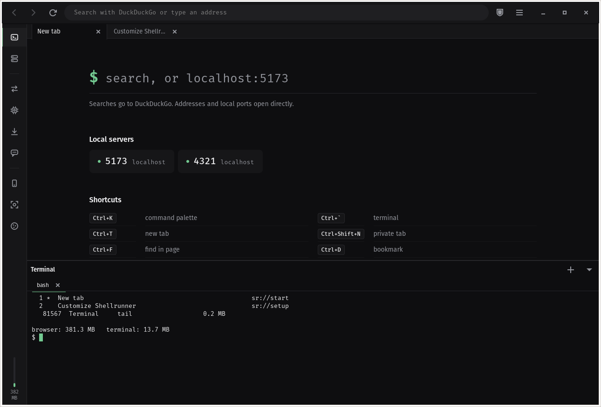
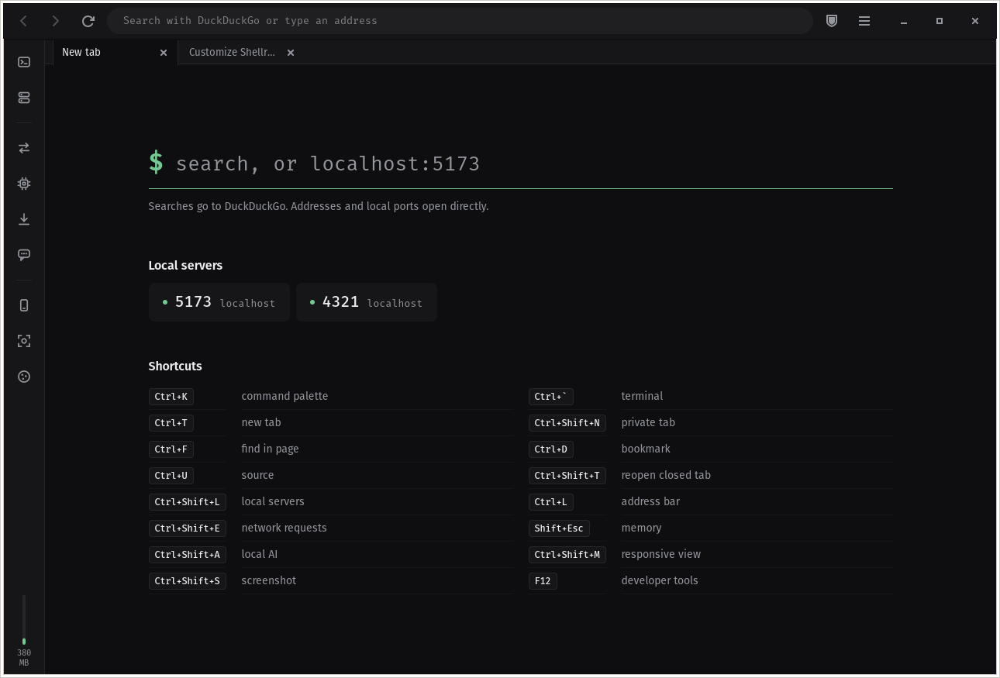
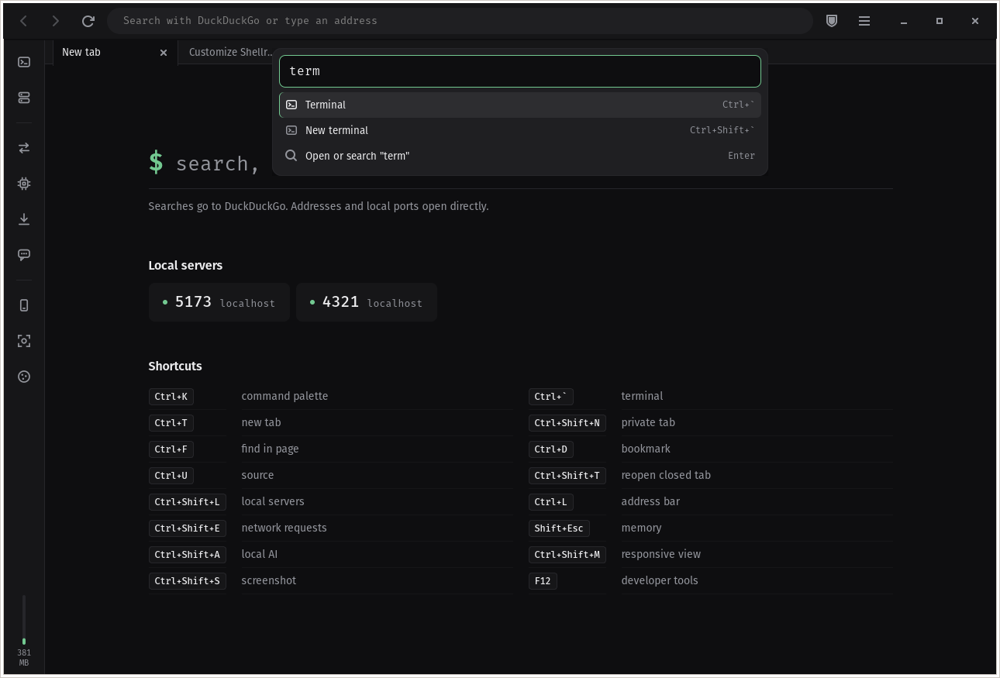
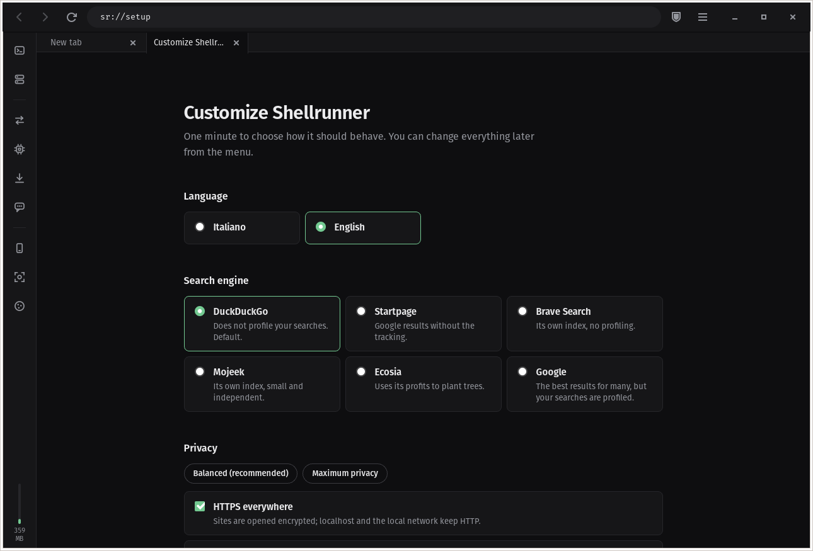

# Shellrunner

A lightweight web browser for Linux developers, with the terminal built in.



Shellrunner puts a WebKit browser and a real terminal (VTE) in the same window,
adds a command palette for everything, and ships with privacy defaults that you
can tune per site. It is written in Python on top of GTK 3 and WebKitGTK, so it
uses the web engine your distribution already keeps up to date.

> **Status: 0.1, early.** Interface in English and Italian.
> See [Known limitations](#known-limitations) before switching your daily browser.

## Why

- **Browser + terminal, one window.** ``Ctrl+` `` slides a terminal up from the bottom;
  ``Ctrl+Shift+` `` opens another one. No alt-tabbing between the dev server and the page.
- **Drive the browser from the shell.** `sr open localhost:5173`, `sr tabs`, `sr mem`.
- **Command palette.** `Ctrl+K` searches actions, open tabs, bookmarks and history.
- **Dev tools where you need them.** Local dev servers detected on the start page,
  network log with "copy as curl", responsive view, full-page screenshots, view source,
  JSON viewer, per-site cookies and storage, memory per process.
- **Local AI, optional.** Summarise a page or explain a selected error with a model
  running in [Ollama](https://ollama.com) on your machine. Nothing leaves your PC.
- **No telemetry.** No analytics, no update pings, no accounts. See [PRIVACY.md](PRIVACY.md).

| Start page | Command palette | First-run setup |
|---|---|---|
|  |  |  |

## Privacy defaults

| Protection | Default |
|---|---|
| HTTPS-only (except localhost and private networks) | on |
| Third-party cookies | blocked |
| Tracker blocklist (local file, editable) | on |
| Canvas/WebGL fingerprinting noise | on |
| Global Privacy Control (`Sec-GPC: 1` header + JS API) | on |
| Referer trimmed to the origin | on |
| Intelligent Tracking Prevention (WebKit) | on |
| WebRTC (can leak your local IP) | off |
| Camera, microphone, location, notifications | always denied |
| Private tabs (ephemeral profile, gone with the last private tab) | `Ctrl+Shift+N` |

On first start a setup page (`sr://setup`) lets you pick the language, the search
engine (DuckDuckGo, Startpage, Brave Search, Mojeek, Ecosia or Google), a balanced
or maximum-privacy preset, your dev server ports and whether to show the AI panel.
Every protection can also be turned off per site from the shield in the address bar.
The blocklist is a plain text file that you own: nothing is downloaded behind your back.

## Install

Shellrunner needs a few system libraries (they cannot come from pip):

```sh
# Debian, Ubuntu, Pop!_OS, Mint
sudo apt install python3-gi python3-gi-cairo gir1.2-gtk-3.0 gir1.2-webkit2-4.1 gir1.2-soup-3.0 gir1.2-vte-2.91 gcc pkg-config libglib2.0-dev

# Fedora
sudo dnf install python3-gobject python3-cairo gtk3 webkit2gtk4.1 libsoup3 vte291 gcc pkgconf glib2-devel

# Arch
sudo pacman -S python-gobject python-cairo gtk3 webkit2gtk-4.1 libsoup3 vte3 gcc pkgconf glib2
```

Then clone the repository and run the installer:

```sh
git clone https://github.com/Tommaso-Palestini/devtox-browser.git && cd devtox-browser
sh install.sh          # installs into ~/.local, no sudo
shellrunner            # or launch it from the applications menu
```

`sh install.sh --uninstall` removes it again (your profile is kept).
You can make it the default browser from the setup page, or with
`xdg-settings set default-web-browser shellrunner.desktop`.

`gcc`, `pkg-config` and the GLib headers are only used once, to compile a tiny
WebKit extension that sets the GPC header and trims the Referer. Without them
Shellrunner still runs, just without those two protections. `shellrunner --check`
shows what is active.

### Run from source

```sh
python3 -m venv --system-site-packages .venv
.venv/bin/python -m shellrunner
```

The Python package is called `shellrunner-browser` (the name `shellrunner` on
PyPI belongs to an unrelated project).

## Keyboard

| Keys | Action |
|---|---|
| `Ctrl+K` | command palette |
| ``Ctrl+` `` / ``Ctrl+Shift+` `` | toggle terminal / new terminal |
| `Ctrl+T`, `Ctrl+W`, `Ctrl+Shift+T` | new, close, reopen tab |
| `Ctrl+Shift+N` | private tab |
| `Ctrl+L`, `Ctrl+F`, `Ctrl+D`, `Ctrl+U` | address bar, find, bookmark, source |
| `Ctrl+Shift+L` | local dev servers |
| `Ctrl+Shift+E`, `Shift+Esc`, `Ctrl+Shift+Y` | network, memory, downloads |
| `Ctrl+Shift+M`, `Ctrl+Shift+S` | responsive view, screenshot |
| `Ctrl+Shift+A` | local AI panel |
| `Ctrl+Shift+Delete` | site cookies and data |
| `F12` | WebKit inspector |

## Command line

```sh
shellrunner [URL ...]        # opens URLs; reuses the running window if there is one
shellrunner --check          # versions, privacy extension status, log path
shellrunner --new-instance   # do not hand URLs to the running window
sr open <url or search>      # new tab in the running browser
sr tabs                      # list tabs (* current, z suspended)
sr mem                       # memory per process
```

## Memory

Measured with `sr mem` (PSS, so shared memory is counted once), WebKitGTK 2.52,
Pop!_OS 24.04, fresh profile:

| Open | Total |
|---|---|
| start page + welcome page + example.com | ~370 MB |
| the above + a Wikipedia article | ~520 MB |

Each tab gets its own web process. Background tabs are suspended after
15 minutes (configurable) and restored tabs are not loaded until you open them.

## Files

| What | Where |
|---|---|
| Settings (JSON, edit by hand or from `sr://setup`) | `~/.config/shellrunner/config.json` |
| Blocklist | `~/.config/shellrunner/blocklist.txt` |
| History, bookmarks, cookies, session | `~/.local/share/shellrunner/` |
| Cache and compiled extension | `~/.cache/shellrunner/` |
| Log (attach it to bug reports) | `~/.local/state/shellrunner/shellrunner.log` |

`sr://about` inside the browser shows versions, paths and the license.

## Known limitations

- **WebKitGTK, not Chromium or Gecko.** Most sites work; some heavy web apps
  (video calls in particular) work better in Chromium-based browsers.
- **Engine security updates come from your distribution's WebKitGTK package**,
  so keep the system updated.
- **The tracker blocklist is small and manual.** It is not uBlock Origin.
- **Fingerprinting protection is partial.** It hides the obvious signals; it does
  not make you anonymous. Use Tor Browser for that.
- No extensions, no sync.

## Contributing

Bug reports, translations and focused pull requests are welcome: see
[CONTRIBUTING.md](CONTRIBUTING.md). Security issues: [SECURITY.md](SECURITY.md).

```sh
python3 -m unittest          # unit tests (no window)
sh scripts/check.sh          # all tests, including a real start-up inside Xvfb
```

## License

Copyright © 2026 XENON1354.

Shellrunner is free software, released under the
[GNU General Public License v3.0 or later](LICENSE). It comes with no warranty.
It uses WebKitGTK, GTK, VTE and PyGObject (LGPL) from your system; none of their
code is bundled here.

Names of other products and services mentioned here (DuckDuckGo, Startpage,
Brave Search, Mojeek, Ecosia, Google, Ollama, Tor Browser, uBlock Origin) are
trademarks of their respective owners. Shellrunner is not affiliated with or
endorsed by any of them.
